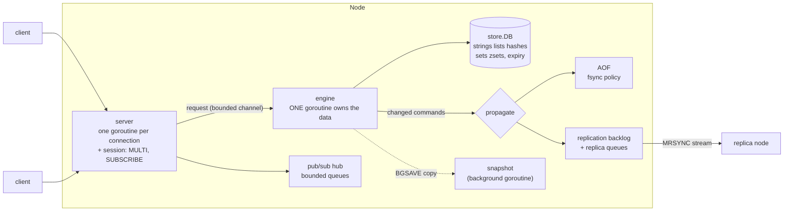

# mini-redis-go

A Redis-compatible in-memory data store written in Go, using only the standard
library. It speaks the Redis protocol (RESP2), so `redis-cli` and client
libraries work against it. It is a learning and portfolio project: every design
choice is written down, and the code is small enough to read in a weekend.

**Why:** to understand how a database server really works - the wire protocol,
a single-threaded command engine, expiry, an append-only log, snapshots,
replication, pub/sub - by building each part, testing it hard, and measuring it.

## Features

- RESP2 protocol, pipelining, 10,000 clients by default, graceful shutdown.
- Strings, lists, hashes, sets and **sorted sets** (own skip list with span
  counts: O(log n) insert, delete, rank and range-by-rank).
- Key expiry: lazy plus a Redis-style sampling sweeper.
- **Single-owner engine**: one goroutine owns all data; no locks on the data.
- Pub/Sub with bounded per-subscriber queues (slow subscribers are disconnected).
- `MULTI` / `EXEC` / `DISCARD` transactions, atomic by construction.
- **Persistence**: append-only file (`always` / `everysec` / `no`), checksummed
  snapshots, `SAVE` / `BGSAVE` / `BGREWRITEAOF`, torn-tail repair.
- `maxmemory` with `noeviction`, `allkeys-lru`, `allkeys-random`, `volatile-ttl`.
- **Replication** with full and partial resync, read-only replicas, expiry
  propagated as `DEL`, slow replicas dropped (private protocol, **not** Redis
  compatible - see below).
- Fuzz tests, benchmarks, a `redis-cli` conformance suite, CI for Linux and Windows.

## Quick start

Requires Go 1.25.3 or newer (the version in `go.mod`).

**Linux / macOS**

```bash
go build -o bin/miniredis ./cmd/miniredis
./bin/miniredis -addr 127.0.0.1:6379
redis-cli -p 6379 PING
```

**Windows (PowerShell)**

```powershell
go build -o bin\miniredis.exe .\cmd\miniredis
.\bin\miniredis.exe -addr 127.0.0.1:6379
# in another terminal, with any redis-cli:
redis-cli -p 6379 PING
```

Stop it with Ctrl+C (or SIGTERM on Linux): it stops accepting, lets running
commands finish, closes connections and exits 0.

With persistence and a memory limit:

```bash
./bin/miniredis -dir ./data -appendonly yes -appendfsync everysec \
                -snapshot-interval 10m -maxmemory 256mb -maxmemory-policy allkeys-lru
```

Run `./bin/miniredis -h` for every flag. Tests: `go test -race ./...`
(`make test`, `make race`). Debian instructions: [docs/DEBIAN_TESTING.md](docs/DEBIAN_TESTING.md).

## Supported commands

| Group | Commands |
|---|---|
| Connection | `PING`, `ECHO`, `QUIT`, `CLIENT SETNAME`, `CLIENT SETINFO` |
| Server | `INFO` (server, clients, memory, stats, persistence, replication, keyspace), `COMMAND` (empty reply), `CONFIG GET` (empty reply), `DBSIZE`, `FLUSHALL`, `FLUSHDB` |
| Strings | `SET` (`EX`, `PX`, `EXAT`, `PXAT`, `NX`, `XX`, `KEEPTTL`), `GET`, `MGET`, `MSET`, `INCR`, `DECR`, `INCRBY`, `DECRBY`, `APPEND`, `STRLEN` |
| Keys | `DEL`, `EXISTS`, `EXPIRE`, `PEXPIRE`, `EXPIREAT`, `PEXPIREAT`, `TTL`, `PTTL`, `PERSIST`, `TYPE`, `KEYS` |
| Lists | `LPUSH`, `RPUSH`, `LPOP`, `RPOP` (optional count), `LLEN`, `LRANGE`, `LINDEX` |
| Hashes | `HSET`, `HGET`, `HDEL`, `HGETALL`, `HEXISTS`, `HLEN` |
| Sets | `SADD`, `SREM`, `SISMEMBER`, `SMEMBERS`, `SCARD` |
| Sorted sets | `ZADD`, `ZREM`, `ZSCORE`, `ZRANK`, `ZRANGE` (by index, `WITHSCORES`), `ZCARD` |
| Pub/Sub | `SUBSCRIBE`, `UNSUBSCRIBE`, `PUBLISH` (exact channel names) |
| Transactions | `MULTI`, `EXEC`, `DISCARD` |
| Persistence | `SAVE`, `BGSAVE`, `BGREWRITEAOF` |
| Replication | `REPLICAOF host port`, `REPLICAOF NO ONE`, and the private `MRSYNC` used between servers |

Not supported: inline commands, `WATCH`, `SELECT` (one database), pattern
subscriptions, Lua, streams, cluster, ACLs, TLS. See
[docs/known-limitations.md](docs/known-limitations.md).

## Architecture



Details: [docs/architecture.md](docs/architecture.md). On-disk formats:
[docs/formats.md](docs/formats.md).

## Design decisions

Each has a record with the options considered and, where applicable, the measurements.

| # | Decision |
|---|---|
| [001](docs/decisions/001-flush-strategy.md) | Flush replies just before the reader would block (pipelining without a deadlock) |
| [002](docs/decisions/002-session-layer.md) | A per-connection session for connection-scoped commands; `Listen`/`Serve` split |
| [003](docs/decisions/003-network-input-limits.md) | Never trust a size from the network: caps, chunked reads |
| [004](docs/decisions/004-shutdown.md) | Graceful shutdown that behaves the same on Windows and Linux |
| [005](docs/decisions/005-single-owner-engine.md) | One goroutine owns the keyspace (chosen for atomic transactions and ordered logging; benchmarked against a mutex, with no reliable throughput difference over TCP) |
| [006](docs/decisions/006-slow-subscribers.md) | Disconnect, never block, a slow subscriber |
| [007](docs/decisions/007-persistence-design.md) | AOF, snapshots and rewrites around the engine; no `fork` |
| [008](docs/decisions/008-eviction-and-replication.md) | Sampled LRU, memory estimate, and a simplified (non-Redis) replication protocol |

For learning, read `docs/learning/phase-N-*.md` in order, then
[docs/interview-notes.md](docs/interview-notes.md).

## Benchmarks

Numbers below were **measured on 2026-10-30** on one Windows laptop (Intel
i5-1230U, 12 logical CPUs, Go 1.25.3, loopback). Results on this machine vary a
lot between runs and between sessions (the same parse benchmark gave about 430 ns
on 2026-10-15 and about 290 ns today), so read them as rough orders of magnitude,
not precise figures. Debian and `redis-benchmark` results are **TBD - measure on
Debian** (run `bench/run.sh`).

`redis-benchmark` vs real Redis (requests/second):

| Test | miniredis P=1 | miniredis P=16 | redis-server P=1 | redis-server P=16 |
|---|---|---|---|---|
| SET / GET / INCR / LPUSH / ... | TBD - measure on Debian | TBD - measure on Debian | TBD - measure on Debian | TBD - measure on Debian |

Go benchmarks (`make bench`; source in `internal/*/bench_test.go`; the 2026-10-15
raw output is in `docs/bench/`). The engine is compared with a mutex-guarded
handler that exists only in the benchmark code (`lockedHandler`). In the TCP
benchmark, 32 connections send a 50/50 GET/SET mix over 10,000 keys.

| What | Result (2026-10-30) |
|---|---|
| TCP, 32 connections, no pipelining | **No reliable difference.** Engine: 115k to 179k commands/s (median 127k, 6 runs). Mutex: 127k to 151k (median 132k, 6 runs). An earlier session measured 134k vs 88k for engine vs mutex; that gap did not reproduce |
| TCP, pipeline depth 16 | Engine 577k, mutex 665k commands/s (median of 3 runs each; the earlier session measured 594k vs 531k) |
| Handler only, no network | Engine 1.19M, mutex 2.69M commands/s (median of 3 runs): the queue hop costs time when there is no network |
| Parse one `SET key value` | about 290 ns, 14 allocations |
| Store `SET` / `GET` on a 100,000-key store (the loop cycles through 1,024 of the keys) | about 23 ns / 19 ns, 0 allocations |
| `ZRANK` + `ZRANGE` of 10 items on 100,000 members | about 1.4 us |
| Copy a 100,000-key keyspace (the BGSAVE pause) | about 7 ms |

## Limitations (short list)

No inline commands; one database; single-threaded data path; memory limit is an
estimate; replication is private to this project; pub/sub is not replicated or
logged; no authentication or TLS. The honest, complete list is
[docs/known-limitations.md](docs/known-limitations.md).

## Project layout

```
cmd/miniredis/        flags, signal handling
internal/app/         wires the parts; Start/Run; pprof; integration tests
internal/server/      TCP server, connections, sessions, shutdown
internal/engine/      the single data-owning goroutine
internal/command/     command table and handlers
internal/store/       the keyspace: typed values, expiry, eviction, Dump/Load
internal/skiplist/    span-counted skip list (sorted sets)
internal/glob/        KEYS patterns
internal/resp/        RESP reader/writer
internal/pubsub/      hub and subscribers
internal/aof/         append-only file, replay, compaction
internal/snapshot/    snapshot format and files
internal/persist/     persistence orchestration
internal/repl/        replication (primary and replica sides)
internal/testclient/  RESP client for tests
conformance/          redis-cli suite, reusable for other implementations
bench/  scripts/      redis-benchmark runner, crash test
docs/                 decisions, learning notes, formats, architecture, Debian guide
```

## License

MIT - see [LICENSE](LICENSE).
